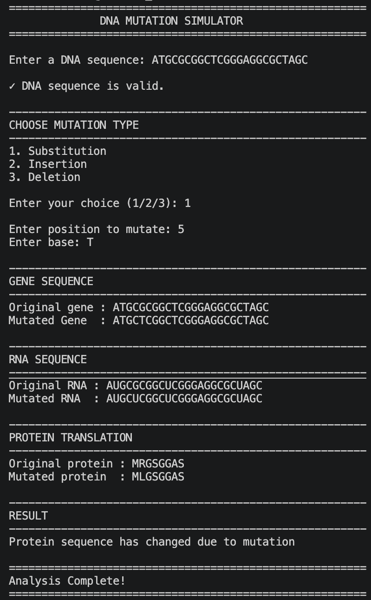

# DNA Mutation Simulator

A Python command-line tool for exploring how a chosen DNA edit changes a translated sequence. Select substitution, insertion or deletion, then compare the original and edited DNA, RNA and protein output.

## Quick start

Requires Python 3 and Git for the clone command. No third-party Python packages are required.

    git clone https://github.com/harshitmishra0310/dna_mutation_simulator.git
    cd dna_mutation_simulator
    python3 dna_mutation_simulator.py

## Example: substitution

Enter these responses in order:

    DNA: ATGGCCATTGTAATGGGCCGCTGA
    Choice: 1
    Position: 5
    Base: T

Key output:

    Original DNA: ATGGCCATTGTAATGGGCCGCTGA
    Mutated DNA:  ATGGTCATTGTAATGGGCCGCTGA
    Original protein: MAIVMGR
    Mutated protein:  MVIVMGR

The second codon changes from GCC to GTC, changing alanine to valine in this translated sequence.

## Position conventions

Positions start at 1. Substitution and deletion accept positions 1 through the sequence length. Insertion places the entered base before the selected position; length + 1 appends it.

## Biological assumptions and limits

- Input is treated as coding-strand DNA. Translation starts at nucleotide 1, uses the standard genetic code, stops at the first stop codon and ignores trailing incomplete codons.
- The current result compares protein strings for equality. It does not automatically classify synonymous, missense, nonsense or frameshift consequences.
- A changed amino acid sequence does not establish a change in protein structure, function or clinical significance.
- Each substitution or insertion accepts exactly one A, T, G or C; invalid positions and bases receive a clear error message.

## Program preview

## Author

Harshit Mishra — B.Tech Bioinformatics student at Shoolini University.

## License

MIT License. See the license file in this repository.
